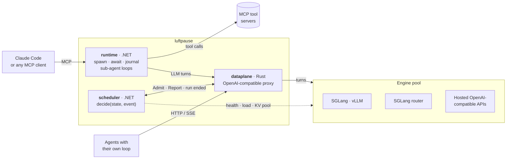

# luftpause

**The runtime layer under your agent harness. Every tool call is an `await`; the
engine forgets the run, luftpause keeps it.**

Tool calls split an agent into turns. To an inference engine each turn is a new
request from nobody: when the tool returns, the continuation queues behind every
batch request that arrived while it waited, and its KV cache may be gone.
luftpause sits between the harness and the engines and keeps the run:

- **Continuations go first.** A run paused on a tool call resumes ahead of batch
  work; batch turns leave room for the interactive runs that will come back.
- **Turns fit the KV pool.** Each turn is admitted against the memory the engine
  reports, with the run's own prefix still on the replica that served it.
- **One caller cannot starve another.** Held turns drain fairly across callers.
- **Any harness, two doors.** Point `base_url` at it (OpenAI-compatible, your own
  loop), or connect over MCP and get `spawn` / `await` sub-agents that survive a
  restart.

Measured on one 8 GB laptop GPU, engines saturated (48 batch runs flooding,
4 interactive runs beside them):

| | Throughput | Latency | What it costs |
|---|---|---|---|
| Agents with their own loop, through luftpause vs straight to the SGLang router | **1.9×** interactive (11.9 vs 6.4 runs/min) | interactive p50 19 s instead of 36 s | batch −8 % |
| Sub-agents over MCP, luftpause vs the runtime straight to the router | **2.1×** interactive (6.5 vs 3.0 runs/min) | interactive p50 32 s instead of 58 s | batch unchanged |
| Fan-out, 16 sub-agents, vs one at a time | **5.3×** (all 16 in 23 s instead of 120 s) | per sub-agent p50 15–22 s, the same as through the router | nothing: the router alone takes 21.5 s |
| Claude Code as the client, six Wikipedia look-ups | **2.9×** (12.5 s instead of 36 s back to back, unprompted) | 70B sub-agents: all six in one round, 9.3 s | 0 failed tool calls, 0 re-spawns |

## Try it

```bash
docker compose up -d --build        # fake engines, no GPU needed; first build takes a few minutes
claude mcp add --transport http --scope local luftpause http://localhost:7000/mcp
```

Claude Code now has `spawn`, `await`, `status`, `cancel` and `tools`. The fake
engines answer with filler — enough to see the fan-out. For real answers put a
model behind it: SGLang on your GPU (`compose.testbed.yaml`) or any
OpenAI-compatible endpoint (`compose.runpod.yaml` shows a hosted vLLM pod).

## How it differs

Routers place requests on a GPU pool; MCP servers delegate a sub-task to a local
model. Neither knows what a run is. luftpause does: it sees every turn and every
tool call of every run, through either door, and schedules them on one shared pool
with three facts an engine never has: that a paused run will come back, what class
of work it is, and who is asking.

The gains come from admission, not from routing. Routing alone ties SGLang's
cache-aware router (below); with the engines idle, every arm ties. The difference
appears when the engines are saturated, which is when it matters.

## Two ways in

- **OpenAI-compatible proxy** — an agent that keeps its own loop points its
  `base_url` at luftpause. It sends `x-luftpause-run-id` per run and, optionally,
  `x-luftpause-class` and `x-luftpause-caller`; every tool call in its loop is then
  a scheduled await.
- **MCP runtime** — an agent such as Claude Code connects over MCP and gets
  `spawn` / `await`. luftpause runs each sub-agent's loop through the same proxy:
  LLM turns on the pool, tool calls to upstream MCP servers, the MCP session as the
  caller, and a journal so the runs outlive the process.

## Architecture



- **runtime** (`runtime/`) — MCP server. Each spawned run is a .NET `Task` running
  the agent loop; tool calls go to the configured MCP servers. Every run is
  journaled to `runs.jsonl` and resumed on restart; a finished run is reported to
  the dataplane (`DELETE /v1/runs/{id}`) so the scheduler forgets it at once.
- **dataplane** (`dataplane/crates/dataplane`) — tokio/axum proxy. Resolves the
  run (header or tool-call ids), reads the class and caller headers, asks the
  scheduler where the turn goes, streams the engine's response through unchanged
  and reports first token, usage and finish reason.
- **scheduler** (`scheduler/`) — the decision core is pure functions over
  immutable state (`Luftpause.Scheduling`); the gRPC host executes the actions.
- **test kit** — `fake-engine` (OpenAI + `/classify` with simulated latency),
  `fake-mcp` (a `lookup` and a slow `deep_search` tool), `tools/loadgen` (agents,
  sub-agent fan-out over MCP, closed-loop throughput runs).

## What it does

| Capability | How |
|---|---|
| `spawn` / `await` over MCP | `spawn(task, model?, serviceClass?, system?, maxToolCalls?, tools?, maxTokens?, parallelToolCalls?, parent?)` returns a handle at once; `await(handles, all\|any, timeout)` collects results with `toolCalls` / `failedToolCalls`; also `tools`, `status`, `cancel`, `decide` |
| Durable runs | every run is journaled (`runs.jsonl` under `Runtime:StateDir`): spawned, each tool round's messages, finished; on restart the runtime replays the journal, answers `await` for finished runs and resumes unfinished ones from their last complete tool round |
| Run tree | `spawn(parent)` makes a run a child; `status` lists `parent` and `children`; `cancel` of a parent cancels its running descendants; the runtime's `GET /status` returns the tree with each run's own work and its subtree's totals (turns, tool calls, failed tool calls, prompt and completion tokens, turn and tool seconds) |
| Status | the scheduler's `GET /status` on `:5001` (HTTP/1; gRPC stays on `:5000`) returns replicas with in-flight turns against capacity and KV tokens in flight against the pool, held turns by class and caller with the oldest wait, and runs by phase and class; `GET /` there is a page that polls it every 2 s, and with `?runtime=http://host:7000` also shows that runtime's run tree and subtree costs |
| Caller fairness | each turn carries `x-luftpause-caller` (the MCP session for sub-agents, any string for own-loop agents); held turns drain `interactive` first, then the caller with the fewest turns in flight, so one caller's flood cannot starve another's |
| Tools apart from turns | a run waiting on a tool holds no turn slot; tool calls run in the runtime against MCP servers over HTTP or stdio; with `spawn(parallelToolCalls: true)` the model may ask for several per reply and they run at once (off by default: Llama 3.x takes one call per reply) |
| Admission by KV memory | an engine that reports its KV pool (SGLang `max_total_num_tokens`) takes a turn while the tokens in flight plus this turn's need fit the pool; the need is estimated from the request's bytes with the tokens-per-byte and reply length observed on that replica; a run that is generating or paused on a tool keeps its replica, so its prefix stays cached |
| Admission by engine load | an engine that reports no KV pool (vLLM) takes turns while it reports no waiting queue (`/metrics`); once it queues, luftpause caps its turns at what the engine runs and holds the rest; engines that report no load are not capped |
| Service classes | batch turns leave room on an engine for each interactive run paused on a tool there, since it will come back; turns held by luftpause go out `interactive` first, then by caller fairness, then by arrival, and wait until placed or until their client disconnects |
| Routers as backends | a replica can be a router (e.g. the SGLang router) that picks the engine; its load is read from the engines behind it (`LoadFrom`) |
| Affinity | a run's next turn goes back to the replica that served its last one, where its prompt prefix is cached |
| Routing by model | endpoints declare the models they serve; a turn only goes to a replica serving its model; an unknown model gets 404 at once |
| Hosted endpoints | any OpenAI-compatible API (vLLM on RunPod, OpenAI, OpenRouter, …) as a replica: API key from an environment variable, health path per endpoint, https |
| Health | `/health` (or any path per endpoint) probed every 2 s; unhealthy replicas receive no turns |
| Tool-call hygiene | arguments coerced to the schema's scalar types, validated, and rejected with the expected shape instead of a silent bad call; calls written as text are recovered |
| Run identity | `x-luftpause-run-id`, or the `tool_call_id`s an agent echoes back |
| Single-pass engines | `POST /v1/decide` (vLLM `/classify` shape) on separate replicas, outside run state |

## Constants

luftpause keeps few fixed numbers. There is no queue deadline and no turn limit: a
held turn waits as it would in the engine's own queue, and a run ends when its tool
budget is spent. What is left:

| Constant | Value | What it does | Where |
|---|---|---|---|
| Reply length | 256 tokens per turn, set per run with `spawn(maxTokens)`, 0 leaves it to the engine | SGLang reserves memory for the longest reply a request may write; without a limit it batched a seventh as many requests (6 vs 42 runs/min on the test bed) and runaway replies broke Llama's one-call-per-reply format | `runtime/…/LuftpauseTools.cs` |
| Tool-call budget | 8 per run, set per run with `spawn(maxToolCalls)` | Once spent, the model is offered no tools and must answer; this also bounds a run's turns at budget + 1 | `runtime/…/LuftpauseTools.cs` |
| `await` timeout | 60 s by default, 600 s at most | How long one `await` call waits before returning the runs' current state; 60 s stays under MCP clients' own per-request limit (Claude Code's is 60 s over HTTP) | `runtime/…/LuftpauseTools.cs` |
| Turn timeout | 10 min | A turn whose completion is never reported (dataplane crashed mid-turn) is dropped and its slot freed | `scheduler/…/Expiry.cs` |
| Run idle expiry | 30 min | A run with no turn for this long is forgotten; its next turn starts without affinity. The runtime reports its sub-agents' ends; agents with their own loop never say they are done, so their state needs an end | `scheduler/…/Expiry.cs` |
| Probe period | 2 s | Engine health and load (`/metrics`) are read this often; admission follows engine load with this delay; also the probe timeout | `scheduler/…/Probing.cs` |
| Clock tick | 1 s | Drives the two expiries above | `scheduler/…/Clock.cs` |
| Runtime → dataplane timeout | 10 min | Longest a single turn may take, queue wait included, before the run fails; the same as the OpenAI and Anthropic clients' default | `runtime/…/Program.cs` |
| 429 retry delay | the response's `Retry-After`, else 1 s | The runtime retries a turn an engine rejects with 429 (a hosted API's rate limit) until the run is cancelled | `runtime/…/LlmClient.cs` |
| Engine connect timeout | 2 s | The dataplane gives up connecting to an engine after this | `dataplane/…/main.rs` |
| Report reconnect | 1 s | The dataplane reconnects its event stream to the scheduler after this pause | `dataplane/…/report.rs` |
| Tool-call id memory | 30 min, pruned every 60 s | How long the dataplane can recognise a run by the `tool_call_id`s its agent echoes back (agents that send no run header) | `dataplane/…/run_identity.rs` |
| Run journal | `Runtime:StateDir`, default `state`, `/var/lib/luftpause` in the container | Where `runs.jsonl` lives; the only state the runtime keeps between restarts | `runtime/…/Program.cs` |
| Caller header | `x-luftpause-caller`, cut at 128 bytes | Identifies the caller for fairness; absent means one shared anonymous caller | `dataplane/…/proxy.rs` |
| KV estimate | 0.25 tokens per request byte until a replica has served a turn | Starting guess for a turn's KV need; replaced by the ratio observed on that replica | `scheduler/…/KvBudget.cs` |

## Running it

```bash
docker compose up -d --build                     # scheduler, dataplane, runtime, fake engines, fake MCP tools
dotnet run --project tools/loadgen -- --spawn 10 # fan 10 sub-agents out over MCP and await them
dotnet run --project tools/loadgen -- --agents 8 --duration-s 60 --class batch --caller me # 8 own-loop agents through the proxy, closed loop
```

On one GPU, two SGLang replicas of Llama-3.2-1B FP8 (the test bed used below):

```bash
docker compose -f compose.yaml -f compose.testbed.yaml up -d --build scheduler dataplane runtime fake-mcp sglang-a sglang-b
```

A hosted vLLM pod as an extra replica (key and pod id from the environment):

```bash
RUNPOD_POD_ID=<pod-id> RUNPOD_KEY=<key> docker compose -f compose.yaml -f compose.testbed.yaml -f compose.runpod.yaml up -d scheduler runtime
```

## Measurements

One laptop, RTX 4060 Laptop 8 GB, two SGLang replicas of Llama-3.2-1B-Instruct FP8
unless stated. Repeats are noted per table; differences inside the spread are
noise.

### Fan-out: `spawn` × 16 + `await all` vs one sub-agent at a time (3 repeats)

16 sub-agents, ~2.8k-token tasks, `lookup` tool fixed at 2 s, up to 3 calls each.

| | Time for all 16 | vs sequential |
|---|---|---|
| sequential (spawn, await, next) | 120.5 s | — |
| luftpause fan-out | 22.9 s | **5.3×** |
| fan-out straight to the SGLang router | 21.5 s | 5.6× |

Per sub-agent, fan-out and router take the same time (p50 15–22 s); the 1.4 s
difference is inside the run-to-run spread.

### Interactive runs under a batch flood (2 repeats, both shown)

48 batch runs flooding the replicas, 4 interactive runs beside them, 3 minutes per
window, 8000-character contexts, up to 3 tool calls per run, closed loop (a finished
run is replaced at once). Both engines queued requests in the no-scheduler arm, so
the pool was saturated. SGLang runs with `--enable-priority-scheduling` in every
row; no priorities are sent.

**Agents with their own loop**, `base_url` at luftpause (`tools/loadgen --agents`):

| | Interactive runs/min | Interactive run time p50 | Batch runs/min |
|---|---|---|---|
| straight to the SGLang router, class-blind | 6.0 / 6.7 | 38.5 s / 33.6 s | 83.7 / 82.3 |
| luftpause, admission by engine load only | 8.7 / 9.0 | 23.2 s / 25.9 s | 79.3 / 79.0 |
| **luftpause, admission by KV memory** | **13.0 / 10.7** | **17.8 s / 20.8 s** | 76.3 / 76.0 |

**Sub-agents over MCP** (`tools/loadgen --spawn`):

| | Interactive runs/min | Interactive run time p50 | Batch runs/min |
|---|---|---|---|
| runtime straight to the SGLang router | 3.0 / 3.0 | 56.6 s / 59.5 s | 39.2 / 36.5 |
| luftpause, admission by engine load only | 4.0 / 5.0 | 44.4 s / 36.7 s | 35.5 / 36.6 |
| **luftpause, admission by KV memory** | **6.3 / 6.6** | **29.7 s / 35.4 s** | 35.5 / 35.5 |

Interactive throughput is about 2× the class-blind router on both paths; batch gives
up 8 % through the proxy and nothing over MCP. The two luftpause rows differ in
admission only: the load-only rule moved 39 of 48 batch runs between replicas
mid-run (losing their prefix cache), the KV rule moved none, so part of its gain is
that stricter affinity. With light load (2000-character contexts, 24 batch runs)
the engines never queue and all rows tie at about 14 interactive runs/min.

### Claude Code as the client

Told to fan out six river look-ups, Claude Code spawned six runs and awaited them
in one call: 12.5 s for the whole fan-out including its own round trips, against
36 s for the same runs back to back.

In a fresh session, asked only to "research these six rivers using the local
sub-agents", it listed the sub-agent tools, restricted the runs to the Wikipedia
tools, spawned six, awaited them in one call and re-spawned the weak answers.
Tools: [wikipedia-mcp](https://pypi.org/project/wikipedia-mcp/) over stdio.

| Sub-agents | Claude's re-spawns | Tool calls rejected | Outcome |
|---|---|---|---|
| 1B local, before argument coercion | 4 | 38 of 46 | answers mostly from model memory |
| 3B local, with coercion | 2 | 0 of 20 | lengths and mouths right, country lists unreliable |
| **Llama 3.3 70B AWQ on a RunPod vLLM pod** | **0** | **0 of 6** | all six from Wikipedia in one round (9.3 s) |

The 70B pod sat in the same pool as the local 3B replica: turns asking for
`llama-3.3-70b` went to the pod over https with its API key, everything else stayed
local. `failedToolCalls` in `await` tells the caller when an answer did not come
from tools.

### Routing (N = 8 sub-agents in flight, 4 repeats)

| | Runs/min | Prompt tokens from cache |
|---|---|---|
| luftpause affinity | 30.1 ± 1.7 | 44.6 % |
| SGLang router, `cache_aware` | 30.1 ± 0.5 | 44.6 % |
| SGLang router, `round_robin` | 28.2 ± 0.5 | 25.7 % |

Affinity equals the SGLang router's cache-aware routing and beats round-robin by
7–15 % at moderate load; at 16–24 runs in flight the caches churn and policy stops
mattering.

### Single-pass (vLLM classifier, RoBERTa-base)

luftpause serves two kinds of model on one pool. A **generative** engine (SGLang,
vLLM, a hosted API) runs an agent's turns: it decodes token by token, keeps a KV
cache per run, and a turn may end in tool calls that pause the run. A
**single-pass** engine answers in one forward pass: an encoder or classifier
(RoBERTa-style, served by vLLM's `/classify`) returns typed labels with
probabilities, no decoding, no stream, no state between calls. Agents use it for
the decisions that do not need a generated reply, such as routing a request,
scoring a tool result or choosing the next step, at a few milliseconds instead of a
generated turn. Sub-agents reach it through the `decide` MCP tool; own-loop agents
through `POST /v1/decide`. Single-pass turns are placed on their own replicas and
never enter run state, so they neither hold nor wait for a generative slot.

| Load | Latency at the data plane |
|---|---|
| one call at a time | p50 20.6 ms |
| 20 concurrent agents | p50 85 ms, p99 180 ms |

## License

[Elastic License 2.0](LICENSE): free to use, modify and redistribute, including inside your company; you may not offer luftpause to others as a hosted or managed service.
